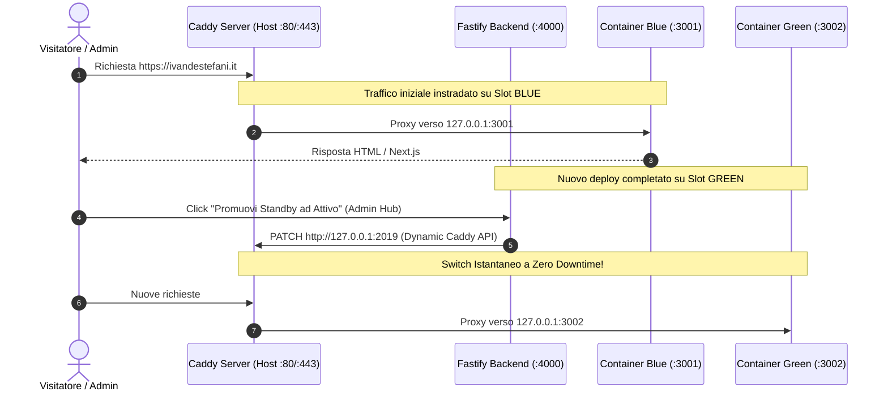

# Guida al Rilascio in Produzione (Server con Caddy Esistente)

Questa guida illustra la configurazione necessaria per deployare **`ivandestefani.it`** sul tuo server Linux dove è già presente ed attivo un servizio **Caddy**.

---

## 🏛️ Architettura di Produzione

Dato che Caddy è già in esecuzione sul server e vincolato alle porte **80** e **443**, i container Docker dell'Hub **non occuperanno le porte pubbliche**, ma si collegheranno in ascolto su `127.0.0.1` (localhost):

| Servizio | Container | Porta Locale | Ruolo |
| :--- | :--- | :--- | :--- |
| **Caddy Esistente** | *Host Service* | `:80`, `:443` | Reverse proxy primario, SSL automatico Let's Encrypt |
| **Backend REST** | `hub-api-prod` | `127.0.0.1:4000` | Fastify REST API, auth SSO, upload file |
| **Frontend Blue** | `hub-web-blue` | `127.0.0.1:3001` | Slot Next.js Attivo (o Standby) |
| **Frontend Green** | `hub-web-green` | `127.0.0.1:3002` | Slot Next.js Standby (o Attivo) |
| **Database** | `hub-mariadb-prod` | `127.0.0.1:3306` | MariaDB 11 con storage persistente |



---

## 🛠️ Step 1: Configurazione del Caddyfile Esistente

Apri il Caddyfile principale del server (solitamente `/etc/caddy/Caddyfile`):

```bash
sudo nano /etc/caddy/Caddyfile
```

### 1.1 Assicurati che l'API Admin sia attiva
In cima al Caddyfile, nel blocco delle opzioni globali, aggiungi:
```caddy
{
    admin 127.0.0.1:2019
}
```

### 1.2 Aggiungi il blocco del sito `ivandestefani.it`
Incolla la seguente configurazione (disponibile anche in [`docker/caddy/production-caddy-snippet.caddy`](file:///Users/ivandestefani/Lavori/new-hub/docker/caddy/production-caddy-snippet.caddy)):

```caddy
ivandestefani.it, www.ivandestefani.it {
    encode zstd gzip

    # Header di sicurezza
    header {
        X-Frame-Options "SAMEORIGIN"
        X-Content-Type-Options "nosniff"
        Referrer-Policy "strict-origin-when-cross-origin"
        Strict-Transport-Security "max-age=31536000; includeSubDomains; preload"
    }

    # Instradamento API Fastify
    handle /api/* {
        reverse_proxy 127.0.0.1:4000
    }

    # Upload statici (PDF Curriculum, immagini di copertina)
    handle /uploads/* {
        reverse_proxy 127.0.0.1:4000
    }

    # Frontend Next.js (Slot iniziale: Blue)
    handle {
        reverse_proxy 127.0.0.1:3001 {
            header_up Host {host}
            header_up X-Real-IP {remote}
            header_up X-Forwarded-For {remote}
            header_up X-Forwarded-Proto {scheme}
        }
    }
}
```

Ricarica Caddy senza disconnettere gli altri siti attivi:
```bash
sudo systemctl reload caddy
# oppure: caddy reload
```

---

## 📦 Step 2: Clonazione e Avvio dei Container sul Server

Sul tuo server:

```bash
# 1. Clona il repository nella directory desiderata
sudo mkdir -p /opt/ivandestefani-hub
sudo chown -R $USER:$USER /opt/ivandestefani-hub
git clone <URL_DEL_TUO_REPO> /opt/ivandestefani-hub
cd /opt/ivandestefani-hub

# 2. Configura le variabili d'ambiente di produzione
cp docker/production.env.example docker/.env
nano docker/.env
```
*(Nel file `.env` imposta password sicure per MariaDB e il JWT secret).*

```bash
# 3. Avvia i container di produzione
docker compose -f docker/docker-compose.prod.yml --env-file docker/.env up -d --build
```

Verifica che tutti i container siano attivi:
```bash
docker ps
```
Dovresti vedere:
- `hub-mariadb-prod` (porta `127.0.0.1:3306`)
- `hub-api-prod` (porta `127.0.0.1:4000`)
- `hub-web-blue` (porta `127.0.0.1:3001`)
- `hub-web-green` (porta `127.0.0.1:3002`)

---

## 🔄 Step 3: Gestione Rilasci Blue/Green e Rollback

Una volta che il sito è online su `https://ivandestefani.it`:

1. **Accesso all'Admin Hub**: Vai su `https://ivandestefani.it/admin`.
2. **Visione Stato Real-Time**: L'indicatore mostrerà quale slot è attivo (`BLUE` o `GREEN`).
3. **Nuovi Rilasci (GitHub Actions)**:
   - Ogni volta che fai `git push` su `main`, la pipeline compila e avvia la nuova versione nello slot di **Standby** (es. `Green` se `Blue` è attivo).
   - Il nuovo rilascio entra in attesa di approvazione manuale (Gating).
4. **Switch Istantaneo a Zero Downtime**:
   - Dalla dashboard clicca su **"Promuovi lo Slot di Standby (GREEN) ad Attivo"**.
   - Il backend comunica con l'API Caddy (`http://127.0.0.1:2019`) e scambia il traffico in meno di un millisecondo senza perdere alcuna connessione attiva!
5. **Rollback d'Emergenza**:
   - Se noti anomalie, clicca su **"Innesca Rollback Istantaneo"**: Caddy ripristinerà immediatamente il traffico sullo slot precedente.
